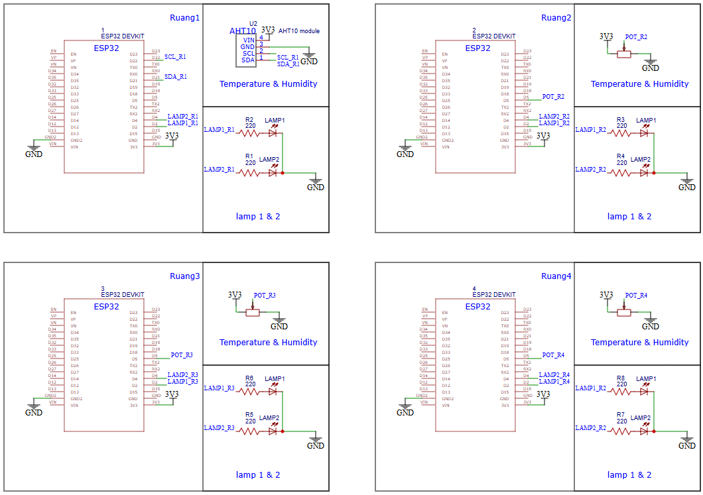
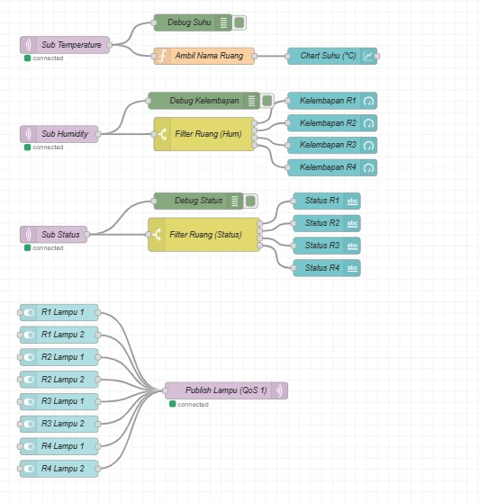
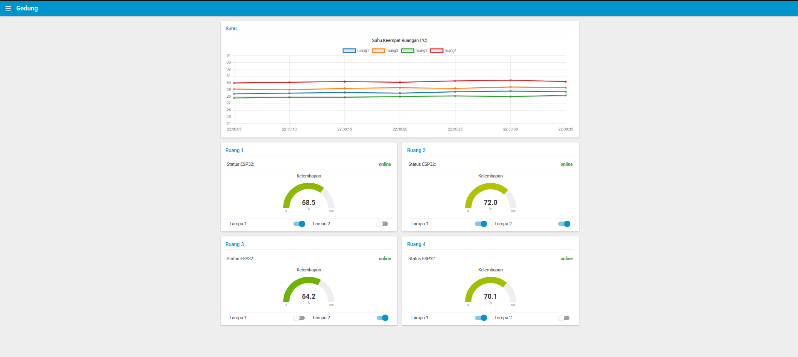

# Tugas Mata Kuliah Jaringan Sensor dan IoT — Kelompok 20

**Materi:** Node-RED dan ESP32 (Lanjutan MQTT pada ESP32)  

---

## 👥 Anggota Kelompok 20 & Pembagian Ruangan

Setiap anggota bertanggung jawab merangkai dan memprogram 1 unit node ESP32 untuk masing-masing ruangan:

| No | Nama Anggota | NRP | Tanggung Jawab Node | Sensor yang Digunakan | Client ID MQTT |
| :-: | :--- | :---: | :---: | :---: | :--- |
| 1 | Moh Adzril Aziz | 2124600095 | **Ruang 1** (`ruang1`) | Modul Sensor **AHT10** (I2C) | `esp32-klp20-ruang1` |
| 2 | Rassya Aditia | 2124600097 | **Ruang 2** (`ruang2`) | **Potensiometer** (`POT_R2`) | `esp32-klp20-ruang2` |
| 3 | Bima Syahputra | 2124600115 | **Ruang 3** (`ruang3`) | **Potensiometer** (`POT_R3`) | `esp32-klp20-ruang3` |
| 4 | Ferrisca Maylanazwa | 2124600117 | **Ruang 4** (`ruang4`) | **Potensiometer** (`POT_R4`) | `esp32-klp20-ruang4` |

---

## 1. Deskripsi & Arsitektur Sistem

Sistem ini memantau kondisi suhu dan kelembapan serta mengendalikan 2 lampu (LED) di **4 ruangan (`ruang1` s/d `ruang4`)** secara *real-time* menggunakan protokol **MQTT** dan **Node-RED Dashboard**.

```text
                           ┌────────────────────┐
  ESP32 ruang1 (AHT10) ────┤                    │
  ESP32 ruang2 (Potensio) ─┤  Broker MQTT       ├──────── Node-RED ──── Browser
  ESP32 ruang3 (Potensio) ─┤  (Mosquitto Lokal  │         (client)      /ui
  ESP32 ruang4 (Potensio) ─┤   Port 1883)       │
                           └────────────────────┘
  publish  : temperature, humidity, status      subscribe: pens/klp20/+/temperature
  subscribe: lamp1, lamp2                                  pens/klp20/+/humidity
                                                           pens/klp20/+/status
                                                publish  : pens/klp20/ruangN/lamp1, lamp2
```

### Konfigurasi Broker MQTT (Mosquitto Lokal)
Sesuai ketentuan tugas, kelompok kami menggunakan **Mosquitto Broker Lokal** yang dijalankan pada laptop server (satu jaringan Wi-Fi/Hotspot dengan keempat ESP32):
- **Host / IP Broker (untuk ESP32):** `10.32.81.35` *(IPv4 WLAN laptop pada jaringan Hotspot)*
- **Host Broker (untuk Node-RED):** `localhost` / `10.32.81.35`
- **Port TCP:** `1883`
- **Konfigurasi `mosquitto.conf`:**
  ```conf
  listener 1883 0.0.0.0
  allow_anonymous true
  ```

---

## 2. Skematik & Konfigurasi Perangkat Keras (Pinout ESP32)

Berdasarkan penyesuaian perangkat keras yang digunakan oleh kelompok kami, **Ruang 1** menggunakan sensor suhu & kelembapan digital **AHT10 (I2C)**, sedangkan **Ruang 2, Ruang 3, dan Ruang 4** menggunakan **Potensiometer** sebagai input suhu dan kelembapan. Seluruh ruangan menggunakan pin **GPIO 2 (`D2`)** untuk Lampu 1 dan **GPIO 4 (`D4`)** untuk Lampu 2.

### 2.1 Tabel Pemetaan Pin Ruang 1 (`esp32/ruang1/ruang1.ino`)
| Komponen | Pin ESP32 | Label Skematik | Keterangan Rangkaian |
| :--- | :---: | :---: | :--- |
| **AHT10 – VIN** | `3V3` | `3V3` | Suplai tegangan 3.3V |
| **AHT10 – GND** | `GND` | `GND` | Ground |
| **AHT10 – SCL** | `GPIO 22` (`D22`) | `SCL_R1` | Jalur I2C Serial Clock |
| **AHT10 – SDA** | `GPIO 21` (`D21`) | `SDA_R1` | Jalur I2C Serial Data |
| **LED Lampu 1 + Resistor 220 Ω** | `GPIO 2` (`D2`) | `LAMP1_R1` | Pin D2 → Resistor R2 (220 Ω) → Anoda LED 1 → Katoda ke GND |
| **LED Lampu 2 + Resistor 220 Ω** | `GPIO 4` (`D4`) | `LAMP2_R1` | Pin D4 → Resistor R1 (220 Ω) → Anoda LED 2 → Katoda ke GND |

### 2.2 Tabel Pemetaan Pin Ruang 2, Ruang 3, dan Ruang 4 (`esp32/ruang2..4`)
| Komponen | Pin ESP32 | Label Skematik | Keterangan Rangkaian |
| :--- | :---: | :---: | :--- |
| **Potensiometer – VCC** | `3V3` | `3V3` | Suplai tegangan 3.3V |
| **Potensiometer – GND** | `GND` | `GND` | Ground |
| **Potensiometer – Wiper (Data)** | `GPIO 5` (`D5`) | `POT_R2` / `POT_R3` / `POT_R4` | Input pembacaan nilai suhu & kelembapan |
| **LED Lampu 1 + Resistor 220 Ω** | `GPIO 2` (`D2`) | `LAMP1_R2..R4` | Pin D2 → Resistor 220 Ω → Anoda LED 1 → Katoda ke GND |
| **LED Lampu 2 + Resistor 220 Ω** | `GPIO 4` (`D4`) | `LAMP2_R2..R4` | Pin D4 → Resistor 220 Ω → Anoda LED 2 → Katoda ke GND |

**Kebutuhan Library & Paket:**
- **Arduino IDE:** `EspMQTTClient` (Patrick Lapointe), `Adafruit AHTX0` (untuk sensor AHT10 pada Ruang 1).
- **Node-RED:** `node-red-dashboard`.

---

## 3. Rancangan Topic MQTT (`klp20`)

Seluruh topic diawali dengan prefix kelompok **`pens/klp20/<nama_ruang>/<fungsi>`** dengan detail spesifikasi sebagai berikut:

| Topic | Arah Komunikasi | Contoh Payload | QoS | Retain |
| :--- | :---: | :--- | :-: | :-: |
| `pens/klp20/ruangN/temperature` | ESP32 → Node-RED | `28.5` (°C, 1 angka desimal) | 0 | Tidak (`false`) |
| `pens/klp20/ruangN/humidity` | ESP32 → Node-RED | `65.0` (%, 1 angka desimal) | 0 | Tidak (`false`) |
| `pens/klp20/ruangN/lamp1` | Node-RED → ESP32 | `1` (Nyala) atau `0` (Mati) | 1 | Tidak (`false`) |
| `pens/klp20/ruangN/lamp2` | Node-RED → ESP32 | `1` (Nyala) atau `0` (Mati) | 1 | Tidak (`false`) |
| `pens/klp20/ruangN/status` | ESP32 / LWT | `online` atau `offline` | 0 | Ya (`true`) |

*(Catatan: `ruangN` mewakili `ruang1`, `ruang2`, `ruang3`, dan `ruang4`).*

### Penggunaan Wildcard pada Node-RED (`mqtt in`)
| Tujuan Subscribe | Topic Wildcard |
| :--- | :--- |
| Suhu seluruh ruangan | `pens/klp20/+/temperature` |
| Kelembapan seluruh ruangan | `pens/klp20/+/humidity` |
| Status koneksi seluruh ruangan | `pens/klp20/+/status` |
| Pemantauan seluruh trafik kelompok (CLI) | `pens/klp20/#` |

---

## 4. Pemenuhan Spesifikasi Sistem

### 4.1 Spesifikasi Node ESP32 (E1 – E7)
- **E1 (Auto-Reconnect & Non-Blocking):** Menggunakan `EspMQTTClient` (`client.loop()`) untuk menangani koneksi Wi-Fi dan MQTT secara otomatis tanpa penggunaan `delay()` panjang di dalam `loop()`.
- **E2 (Unique Client ID):** Setiap ESP32 memiliki ID unik `esp32-klp20-ruang1` hingga `esp32-klp20-ruang4`.
- **E3 (Last Will and Testament / LWT):** Mendaftarkan LWT pada `setup()` melalui `client.enableLastWillMessage(T_STATUS, "offline", true)` dengan *Keep Alive* 15 detik.
- **E4 (On Connection Established):** Saat tersambung ke broker, ESP32 melakukan *subscribe* ke topic `lamp1` dan `lamp2` masing-masing ruangan (QoS 1) dan mem-*publish* pesan `"online"` (*retain* = `true`) ke topic `status`.
- **E5 (Pembacaan Sensor Periodik 5 Detik):** Menggunakan pewaktu `millis()` setiap `5000 ms` untuk membaca suhu dan kelembapan (dari AHT10 pada Ruang 1 serta Potensiometer pada Ruang 2–4) dalam format 1 desimal (`String(val, 1)`).
- **E6 (Validasi Payload Aktuator):** Fungsi kendali lampu hanya mengeksekusi payload `"1"` (`HIGH` pada GPIO 2 / GPIO 4) dan `"0"` (`LOW`), serta mengabaikan payload lainnya.
- **E7 (Modularitas Kode):** Pembentukan seluruh topic dan Client ID otomatis mengikuti makro `#define KELOMPOK "klp20"` dan `#define ROOM "ruangN"`.

### 4.2 Spesifikasi Flow & Dashboard Node-RED (N1 – N7)
- **N1:** Seluruh node `mqtt in` dan `mqtt out` terhubung ke 1 konfigurasi `mqtt-broker` yang sama (`Mosquitto Lokal`).
- **N2:** Grafik suhu menggunakan 1 node `ui_chart` (tipe *Line*) yang menampilkan 4 garis sekaligus (`ruang1` s/d `ruang4`) melalui pemrosesan `msg.topic` di node `function`.
- **N3:** Menampilkan 4 buah `ui_gauge` kelembapan (rentang 0–100%) untuk masing-masing ruangan.
- **N4:** Menyediakan 8 saklar (`ui_switch`) untuk mengendalikan `lamp1` dan `lamp2` di keempat ruangan melalui `mqtt out` dengan **QoS 1**.
- **N5:** Menampilkan 4 indikator teks (`ui_text`) untuk memantau status `online`/`offline` setiap ruangan secara *real-time*.
- **N6:** Setiap jalur `mqtt in` dilengkapi node `debug` (`Debug Suhu`, `Debug Kelembapan`, `Debug Status`).
- **N7:** Tata letak dashboard terorganisir dalam 1 Tab (`Gedung`) yang memuat grup `Suhu` serta grup `Ruang 1`, `Ruang 2`, `Ruang 3`, dan `Ruang 4`.

---

## 5. Struktur Repositori

```text
├── Node-Red/
│   └── flows_klp20.json            # File export flow Node-RED Kelompok 20
├── docs/
│   ├── images/
│   │   ├── dashboardUI.png         # Screenshot halaman dashboard Node-RED (/ui)
│   │   ├── flow.png                # Screenshot flow Node-RED Kelompok 20
│   │   └── rangkaian.jpg           # Gambar skematik rangkaian Ruang 1 - Ruang 4
│   └── docs                        # Catatan dokumentasi tambahan
├── esp32/
│   ├── ruang1/
│   │   └── ruang1.ino              # Source code ESP32 Ruang 1 (Sensor AHT10)
│   ├── ruang2/
│   │   └── ruang2.ino              # Source code ESP32 Ruang 2 (Potensiometer)
│   ├── ruang3/
│   │   └── ruang3.ino              # Source code ESP32 Ruang 3 (Potensiometer)
│   └── ruang4/
│       └── ruang4.ino              # Source code ESP32 Ruang 4 (Potensiometer)
├── video/
│   └── link.md                     # Tautan video demonstrasi sistem
└── README.md                       # Laporan utama proyek Kelompok 20
```

---

## 6. Hasil Pengujian & Dokumentasi

### Daftar Pengujian Sistem (T1 – T12)
| No | Kode Uji | Skenario Pengujian | Prosedur & Langkah Uji | Hasil yang Diharapkan | Status |
| :-: | :-: | :--- | :--- | :--- | :-: |
| 1 | **T1** | Koneksi Wi-Fi Awal | Menyalakan ESP32 Ruang 1 s.d. Ruang 4 | ESP32 berhasil tersambung ke jaringan Wi-Fi/Hotspot lokal | ✅ Berhasil |
| 2 | **T2** | Koneksi ke Broker MQTT | Memantau Serial Monitor saat ESP32 *booting* | ESP32 berhasil melakukan koneksi ke Mosquitto Broker (`10.32.81.35:1883`) | ✅ Berhasil |
| 3 | **T3** | Status Online Awal (*Retained*) | Membuka dashboard Node-RED di browser (`/ui`) | Indikator status keempat ruangan langsung menampilkan teks **`online`** | ✅ Berhasil |
| 4 | **T4** | *Publish* Data Suhu Sensor | Membaca pengiriman data sensor periodik setiap 5 detik | Node-RED menerima data suhu valid dan menampilkannya pada chart line | ✅ Berhasil |
| 5 | **T5** | *Publish* Data Kelembapan | Memantau pembaruan nilai kelembapan berkala | Keempat node `ui_gauge` menampilkan nilai persentase kelembapan dengan akurat | ✅ Berhasil |
| 6 | **T6** | Validasi Sensor Gagal (`isnan`) | Menguji kondisi sensor terlepas sementara | Pembacaan gagal (`isnan`) tidak dikirim ke broker (mencegah data korup) | ✅ Berhasil |
| 7 | **T7** | Kontrol Lampu 1 (`D2`) ON/OFF | Menekan saklar Lampu 1 pada dashboard untuk setiap ruangan | LED fisik Lampu 1 (`GPIO 2`) menyala dan mati seketika sesuai perintah | ✅ Berhasil |
| 8 | **T8** | Kontrol Lampu 2 (`D4`) ON/OFF | Menekan saklar Lampu 2 pada dashboard untuk setiap ruangan | LED fisik Lampu 2 (`GPIO 4`) menyala dan mati seketika sesuai perintah | ✅ Berhasil |
| 9 | **T9** | Validasi Filter Payload Aktuator | Mengirim payload selain string `"1"` atau `"0"` | Sistem mengabaikan payload di luar ketentuan dan mempertahankan status LED | ✅ Berhasil |
| 10 | **T10** | Uji Last Will & Testament (LWT) | Mencabut catu daya (kabel USB) salah satu ESP32 secara paksa | Setelah batas *Keep Alive* (~15 detik), indikator status ruang berubah jadi **`offline`** | ✅ Berhasil |
| 11 | **T11** | Auto-Reconnect Perangkat | Menghubungkan kembali catu daya ESP32 yang sebelumnya dicabut | ESP32 otomatis *reconnect* ke Wi-Fi & broker, lalu status kembali jadi **`online`** | ✅ Berhasil |
| 12 | **T12** | Konsistensi Wildcard Node-RED | Menguji penangkapan data masukan via topic *wildcard* | Node `mqtt in` dengan *wildcard* (`pens/klp20/+/...`) berhasil merouting data dengan tepat | ✅ Berhasil |

### Tautan Video Demo & Tangkapan Layar
- **Link Video Demo:** Lihat pada file [`video/link.md`](video/link.md)
- **File Flow Node-RED:** [`Node-Red/flows_klp20.json`](Node-Red/flows_klp20.json)

#### 1. Skematik Rangkaian 4 Ruangan (`rangkaian.jpg`)


#### 2. Flow Node-RED (`flow.png`)


#### 3. Tampilan Dashboard Node-RED (`dashboardUI.png`)

